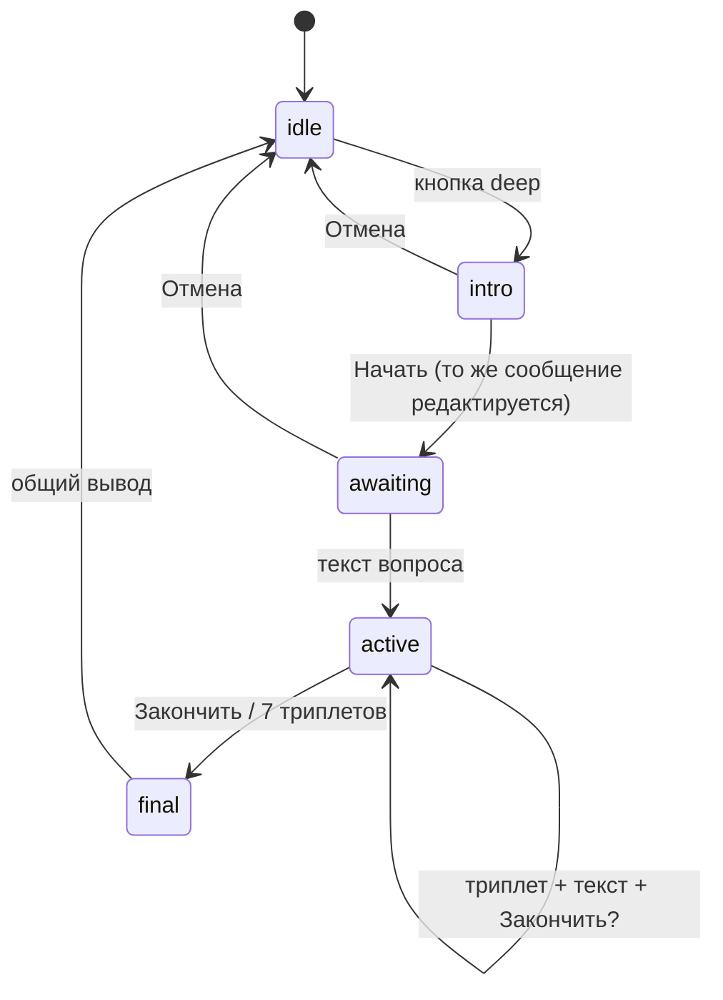

# Roadmap: минорные релизы

План улучшений **без** ветвления UX по уровню опыта пользователя. Сутки для лимита «карты дня» — **календарные** в **`DAY_DRAW_TIMEZONE`** (IANA; целевой дефолт **UTC+3** = `Europe/Moscow`, см. **2.11**). Бот — **только личные сообщения** (private).

**Текущая версия в репозитории:** **3.4.0** — [CHANGELOG.md](../CHANGELOG.md), `package.json`. **Навигация для агентов:** [AGENTS.md](../AGENTS.md). Эпик **3.0 — Глубинная диагностика** — [ниже](#ветка-30--глубинная-диагностика). Релизы **3.2–3.4** (UX, intro, копирайт) — в CHANGELOG. Milestone **v1.4.0–v1.9.0** **реализованы**; ветка **2.x** и эпик **2.11–2.18** (post-roast) — **закрыт**, кроме **2.16** (backlog).

### План ветки 2.x (польза и ощущение)

| Версия        | Фокус                                                                                                                                                                                                                                                                                                                                                                                                                                                                                                                                           |
| ------------- | ----------------------------------------------------------------------------------------------------------------------------------------------------------------------------------------------------------------------------------------------------------------------------------------------------------------------------------------------------------------------------------------------------------------------------------------------------------------------------------------------------------------------------------------------- |
| **2.1**       | Единые формулировки про сутки и время (в т.ч. не Москва), команда **`/status`**, понятное включение рассылки, меньше «тишины» при повторных нажатиях, подсказки после расклада и при пустом **`/last`**.                                                                                                                                                                                                                                                                                                                                        |
| **2.2**       | **`/last`** в SQLite (переживает перезапуск); пресеты и **`/pushtime`** для времени ежедневной рассылки.                                                                                                                                                                                                                                                                                                                                                                                                                                        |
| **2.3**       | **Своё время рассылки:** любое локальное **`ЧЧ:ММ`** через **`/pushtime 14:30`**; пресеты в чате по-прежнему для быстрого выбора.                                                                                                                                                                                                                                                                                                                                                                                                               |
| **2.4**       | **UX: меньше шагов** (аудит 2026-04): подписка на рассылку **без обязательного второго экрана** времени (дефолт из env + кнопка **«Время рассылки»** / **`/pushtime`**); первый «на день» — **сразу полная клавиатура** под текстом, без отдельного экрана только с подпиской и **`/menu`**; расклад «три карты» — **хинт в конце последнего сообщения**, не отдельным пушем; **`/last`** — клавиатура на **каждом** чанке; тихий **`answerCbQuery`** при выборе пресета времени; убраны лишние отсылки к **`/menu`** там, где уже есть кнопки. |
| **2.5**       | **UX второй проход:** расклад «три карты» **без отдельного** «Секунду…» (только индикатор набора); ответы **«На день»** при debounce / лимите / ошибке ИИ и **отказ whitelist** — **с клавиатурой**; после подписки и после смены времени — клавиатура с **отпиской** и **«Время рассылки»**; **`/status`** — строка команд с **`/pushtime`** и **`/promo`**.                                                                                                                                                                                   |
| **2.6**       | **Ожидание ИИ без лишнего сообщения** у ручного **«На день»**: как у расклада в три карты и у push — только **`typing`** через `withTypingWhile` / `withTelegramTypingWhile`, без отдельной строки «Секунду…» в чате.                                                                                                                                                                                                                                                                                                                           |
| **2.7**       | Прод на **DigitalOcean** (Docker Compose, SSH deploy после CI).                                                                                                                                                                                                                                                                                                                                                                                                                                                                                 |
| **2.8**       | **OpenRouter** вместо Cloudflare; цепочка free-моделей.                                                                                                                                                                                                                                                                                                                                                                                                                                                                                         |
| **2.9**       | Полоса «карта дня»; толкование **ответом** на фото расклада.                                                                                                                                                                                                                                                                                                                                                                                                                                                                                    |
| **2.10**      | Нейтральные тексты суток; временно **UTC** в коде; fix deploy `script_stop` (дефолт суток → **UTC+3** в **2.11**).                                                                                                                                                                                                                                                                                                                                                                                                                              |
| **2.11–2.18** | Надёжность лимита дня, рассылки, разрезание `bot.ts`, delivery, ИИ/ops — [ниже](#ветка-211--надёжность-и-поддерживаемость-post-roast-2026-05) (**2.16** — backlog).                                                                                                                                                                                                                                                                                                                                                                             |
| _Позже_       | Мягкие напоминания, экспорт — отдельными минорами с оценкой PRIVACY и оператора.                                                                                                                                                                                                                                                                                                                                                                                                                                                                |
| **3.0**       | **Глубинная диагностика** — сессия до 7 триплетов, финал — [ниже](#ветка-30--глубинная-диагностика) (**выпущено**)                                                                                                                                                                                                                                                                                                                                                                                                                              |

## Ветка 3.0 — Глубинная диагностика

Поколение продукта **3.x**; релиз в репозитории — **один** тег **`v3.0.0`** (без цепочки 3.1, 3.2 в `package.json`). Тон и формат толкования — [BRAND-GUIDE.md](./BRAND-GUIDE.md) §5.1; термины — [GLOSSARY.md](./GLOSSARY.md); данные сессии — [PRIVACY.md](./PRIVACY.md) §6.

Сессионный расклад: до **7 триплетов** (по 3 карты) на одно гадание, с финальным выводом **без новых карт**. Кнопка: **«Глубинная диагностика»**; callback: `deep`. Также: `deep_start`, `deep_cancel`, `deep_end`.

### Продукт

| Параметр            | Решение                                                                                                                     |
| ------------------- | --------------------------------------------------------------------------------------------------------------------------- |
| Доступ              | **Публичный**; spread и полный deep — **Premium** / админ (`accessTier.ts`)                                                 |
| Сессий              | Неограниченно; в одной — до **7** триплетов                                                                                 |
| Ввод                | После **«Начать»** (`deep_start`) — **текст** (вопрос или утверждение); до «Начать» текст не принимается                    |
| Отмена              | **«Отмена»** (`deep_cancel`) до первого триплета (без карт); на intro и до ответа на первый вопрос                          |
| Фазы сессии         | `intro` → `awaiting_first_question` → `in_chain` (`DeepSessionPhase` в `sessionStore.ts`)                                   |
| Во время сессии     | `/menu`, `/help` и чужие callback — **ответ** с подсказкой и «Закончить гадание»; расклады «На день» / spread — то же       |
| Выход               | **«Закончить гадание»** (`deep_end`) после каждого триплета или лимит 7                                                     |
| Карты               | До **21 уникальной** за сессию (без повторов между триплетами)                                                              |
| Толкование триплета | ~**2 абзаца**, без меток `READING_SECTION_LABELS`                                                                           |
| Продолжение         | Текст в чат + «Можешь задать ещё один вопрос…» + кнопка «Закончить гадание»                                                 |
| Финал               | После 7-го триплета (сначала его текст) или по «Закончить»; метки **Общая картина**, **На что обратить внимание**, **Итог** |
| Сбой ИИ             | Триплет **не засчитывается**; «отправь тот же вопрос ещё раз»                                                               |
| Состояние           | **in-memory**, TTL **24 ч**; рестарт процесса — сессия теряется (сообщение пользователю не шлётся)                          |

### Поток (пользователь)

1. **Intro (3.3):** короткий текст, **Начать** + **Отмена**; дисклеймер — в `/help`, не в intro. **Начать** переводит то же сообщение в «напиши первый вопрос» (без второго пуша).
2. **Триплет:** фото → толкование (ответ на фото) → приглашение к следующему вопросу → **«Закончить гадание»**.
3. **Триплеты 2–7:** накопительный коллаж (наслоение) + тот же цикл.
4. **Финал:** запрос к ИИ → длинный вывод → обычное меню.

Повторный клик **«Глубинная диагностика»** при активной сессии — текст «гадание уже идёт» (с **3.2**).

### Визуал

| Шаг         | Изображение                                                                                                                                                                                    |
| ----------- | ---------------------------------------------------------------------------------------------------------------------------------------------------------------------------------------------- |
| 1-й триплет | Полоса из 3 карт — **идентично** spread (`tripletStripFrame` в `spreadComposite.ts`)                                                                                                           |
| 2–7         | Наслоение: триплет _k_ поверх предыдущего стола, `top = k × 12.5%` высоты карты (`STRIP_CARD_HEIGHT`); лёгкая тень у верхнего края новой полосы; лимит Telegram — `DEEP_COMPOSITE_MAX_SIDE_PX` |

**Подпись к фото:** вопросы в «ёлочках» с номером (`1. `, `2. ` …), между вопросами пустая строка; **текущий** — `<b>…</b>` (без «2 из 7» в тексте).

### Модель C — уровни доступа (4.x, реализовано)

| Уровень       | Кто                                         | «На день» | Глубинная диагностика                     | Spread «Прошлое — настоящее — будущее» |
| ------------- | ------------------------------------------- | --------- | ----------------------------------------- | -------------------------------------- |
| **`basic`**   | все без Premium                             | да        | до **3** триплетов, **без** общего финала | нет (нужен Premium)                    |
| **`premium`** | `premium_until`, промокод `/promo` (31 дн.) | да        | до **7** триплетов + общий финал          | да                                     |
| **`admin`**   | `ADMIN_TELEGRAM_USER_IDS` / флаг в БД       | да        | как premium                               | да                                     |

Код: `src/accessTier.ts`, `src/tierDisplay.ts`; промокоды — `/admin promo`, `/admin promo list` (31 день, автогенерация). Бот публичный. Команды: [DEPLOY.md](./DEPLOY.md).

### ИИ

| Вызов   | Вход                                                    | Выход пользователю                                                             |
| ------- | ------------------------------------------------------- | ------------------------------------------------------------------------------ |
| Триплет | Вопрос дословно; 3 карты; резюме прошлых шагов (кратко) | 1–2 коротких абзаца, символы на картах + скрытое **РЕЗЮМЕ:** (2–3 предложения) |
| Финал   | Все вопросы дословно + все резюме                       | 5–6 абзацев с метками финала (см. `brandFormatDeepFinalPromptBlock`)           |

**Russian gate** на каждый вызов (как у остальных раскладов). Длинный вопрос обрезается при превышении лимита подписи/промпта (`DEEP_MAX_QUESTION_CHARS`).

### Код

| Модуль                                        | Назначение                        |
| --------------------------------------------- | --------------------------------- |
| `src/deepReading/sessionStore.ts`             | Сессии, TTL, состояния            |
| `src/deepReading/sessionDeck.ts`              | Реэкспорт `shuffledDeckIds`, draw |
| `src/deepReading/prompts.ts`                  | Промпты триплета и финала         |
| `src/deepReading/deepReadingCaption.ts`       | HTML-подпись с вопросами          |
| `src/deepReading/compositeStack.ts`           | Накопительный коллаж              |
| `src/deepReading/deepReadingDelivery.ts`      | Оркестрация                       |
| `src/handlers/registerDeepReadingHandlers.ts` | Кнопки и текст                    |
| `src/handlers/middleware.ts`                  | `registerDeepSessionMiddleware`   |

### Оператор

- Один процесс на дроплете — как для `dayInFlight`.
- До **8** вызовов OpenRouter на полную сессию (7 триплетов + финал) — логи `[ai_error]` в [DEPLOY.md](./DEPLOY.md).

### План релиза 3.0.0 (внутренние этапы, не SemVer)

| Этап      | Содержание                                     | Статус      |
| --------- | ---------------------------------------------- | ----------- |
| v3-deep-1 | Сессия, middleware, копирайт, клавиатуры       | реализовано |
| v3-deep-2 | Триплет, полоса, промпт, резюме, цикл вопросов | реализовано |
| v3-deep-3 | Накопительный коллаж, подписи с «»             | реализовано |
| v3-deep-4 | Финал + help, PRIVACY, BOTFATHER, GLOSSARY     | реализовано |

**Не входит в 3.0:** SQLite для сессий; доступ только для whitelist; отдельная команда `/deep`.

### Ограничения при доработках (актуально для 3.x)

- In-memory deep, TTL 24 ч — без SQLite для сессии.
- Только кнопка `deep` — **без** команды `/deep`.
- «На день»: порядок **ИИ → фото → текст**; HTML, не MarkdownV2.
- Не менять промпты OpenRouter и логику коллажа без отдельной задачи (копирайт — `botCopy.ts`).
- В подписи к фото deep — **без** счётчика «N из 7»; прогресс только в сообщениях бота.
- Обращение на **ты** в `botCopy.ts` ([BRAND-GUIDE.md](./BRAND-GUIDE.md) §1).

---

## GitHub: milestones и issues

**v1.4–v1.9:** milestones [v1.4.0](https://github.com/findscode/vodovorot-bot/milestone/1) … [v1.9.0](https://github.com/findscode/vodovorot-bot/milestone/6), issues [#8](https://github.com/findscode/vodovorot-bot/issues/8) … [#20](https://github.com/findscode/vodovorot-bot/issues/20).

**v2.11–v2.18 (надёжность):** milestones [v2.11.0](https://github.com/findscode/vodovorot-bot/milestone/7) … [v2.17.0](https://github.com/findscode/vodovorot-bot/milestone/13), issues [#37](https://github.com/findscode/vodovorot-bot/issues/37) … [#46](https://github.com/findscode/vodovorot-bot/issues/46) — таблица [ниже](#github-milestones-211-v2x-надёжность). **2.18.0** — без отдельного milestone/issue (см. [CHANGELOG 2.18](../CHANGELOG.md#2180--2026-05-20)).

| Roadmap ID | Issue                                                       |
| ---------- | ----------------------------------------------------------- |
| v1.4-1     | [#8](https://github.com/findscode/vodovorot-bot/issues/8)   |
| v1.4-2     | [#9](https://github.com/findscode/vodovorot-bot/issues/9)   |
| v1.4-3     | [#10](https://github.com/findscode/vodovorot-bot/issues/10) |
| v1.4-4     | [#11](https://github.com/findscode/vodovorot-bot/issues/11) |
| v1.5-1     | [#12](https://github.com/findscode/vodovorot-bot/issues/12) |
| v1.5-2     | [#13](https://github.com/findscode/vodovorot-bot/issues/13) |
| v1.6-1     | [#14](https://github.com/findscode/vodovorot-bot/issues/14) |
| v1.7-1     | [#15](https://github.com/findscode/vodovorot-bot/issues/15) |
| v1.7-2     | [#16](https://github.com/findscode/vodovorot-bot/issues/16) |
| v1.8-1     | [#17](https://github.com/findscode/vodovorot-bot/issues/17) |
| v1.8-2     | [#18](https://github.com/findscode/vodovorot-bot/issues/18) |
| v1.8-3     | [#19](https://github.com/findscode/vodovorot-bot/issues/19) |
| v1.9-1     | [#20](https://github.com/findscode/vodovorot-bot/issues/20) |

Зависимости в комментариях: [#13](https://github.com/findscode/vodovorot-bot/issues/13) блокируется [#12](https://github.com/findscode/vodovorot-bot/issues/12); [#10](https://github.com/findscode/vodovorot-bot/issues/10) согласовать с [#9](https://github.com/findscode/vodovorot-bot/issues/9).

## Статус реализации

| ID         | Сделано | Где смотреть                                                                                                                                                            |
| ---------- | ------- | ----------------------------------------------------------------------------------------------------------------------------------------------------------------------- |
| **v1.4-1** | ✅      | `src/handlers/middleware.ts`: только `private`, без `next()`; [DEPLOY.md](./DEPLOY.md) — бот только для ЛС                                                              |
| **v1.4-2** | ✅      | `bot.command('help')`, `helpTextHtml` в `src/botCopy.ts`                                                                                                                |
| **v1.4-3** | ✅      | Общие тексты в `src/botCopy.ts`; лимит согласован с Москвой (v1.5)                                                                                                      |
| **v1.4-4** | ✅      | `src/typingIndicator.ts` → `withTypingWhile` в хендлерах `day` / `spread`                                                                                               |
| **v1.5-1** | ✅      | `dayDrawCalendarDate`, `getDayDrawTimezone`, `DAY_DRAW_TIMEZONE`, `Intl`; `src/dayDrawState.ts`, тесты (имя уточнено в **2.11**)                                        |
| **v1.5-2** | ✅      | `botCopy.ts`, [DEPLOY.md](./DEPLOY.md), [.env.example](../.env.example), [CHANGELOG 1.9.0](../CHANGELOG.md#190--2026-04-09); UTC убран из пользовательских формулировок |
| **v1.6-1** | ✅      | `src/ai.ts` (`SYSTEM_PROMPT`), `src/prompts.ts`, `src/brandFormat.ts`; финальная «рамка» в промпте                                                                      |
| **v1.7-1** | ✅      | Слот после успеха ИИ (1.9); уточнено в **2.12** — резерв до выдачи; debounce, `dayInFlight`; [DEPLOY.md](./DEPLOY.md)                                                   |
| **v1.7-2** | ✅      | Дружелюбные ответы в handlers; `[ai_success]` / `[ai_error]` в `ai.ts`; таймаут `AbortError`                                                                            |
| **v1.8-1** | ✅      | Последний чанк с клавиатурой в `readingChunksDelivery.ts` (общий модуль с **2.15**)                                                                                     |
| **v1.8-2** | ✅      | `answerCbQuerySafe`; комментарий в [DEPLOY.md](./DEPLOY.md) (просроченные callback)                                                                                     |
| **v1.8-3** | ✅      | Таблица команд в [DEPLOY.md](./DEPLOY.md); расширено командой `last` (v1.9); детали — [BOTFATHER.md](./BOTFATHER.md)                                                    |
| **v1.9-1** | ✅      | `src/lastReadingStore.ts`, `/last` в SQLite; help и DEPLOY обновлены                                                                                                    |

### Статус 2.11–2.18 (post-roast)

| Версия   | Сделано | Где смотреть                                                                      |
| -------- | ------- | --------------------------------------------------------------------------------- |
| **2.11** | ✅      | `dayDrawState.ts` — дефолт `Europe/Moscow`; `dayDrawCalendarDate`                 |
| **2.12** | ✅      | `cardOfDayDelivery.ts`, `dayDrawSlotsRepo.ts` — резерв слота до выдачи, `release` |
| **2.13** | ✅      | `dayPushScheduler.ts`, `dayPushAiRetry.ts`                                        |
| **2.14** | ✅      | `src/handlers/`, тонкий `bot.ts`                                                  |
| **2.15** | ✅      | `readingChunksDelivery.ts`, `registerErrorHandler.ts`                             |
| **2.16** | backlog | [DEPLOY.md](./DEPLOY.md) — порог ~50+ подписчиков push                            |
| **2.17** | ✅      | Runbook в [DEPLOY.md](./DEPLOY.md#логи-и-runbook-оператор)                        |
| **2.18** | ✅      | `aiErrors.ts`, `cardOfDayDelivery.ts` — ИИ→фото, `delivery_error`                 |

**Уточнение по v1.4-1:** в критериях «не передавать дальше в бизнес-логику» достигается **без** вызова `next()` для групп/каналов (тихий `return`).

**Релизы:** v1.4.x — [CHANGELOG 1.4.0–1.4.2](../CHANGELOG.md); единый минор **1.9.0** — закрытие v1.5–v1.9 (и донастройка связанного копирайта).

## Как использовать с агентом или в GitHub Issues

> **Архив шаблонов v1.4–v1.9 и v2.11–v2.17** ниже — исходные спецификации issues; чеклисты `- [ ]` не обновляются. Факт реализации — в таблицах «Статус реализации» и «Статус 2.11–2.18».

1. Создайте **milestone** на GitHub с именем релиза (например `v1.4.0`) или работайте по эпику в одном PR.
2. Для каждого блока ниже создайте **отдельную issue**: заголовок = поле **Title**, описание = **Description** + **Acceptance criteria** (чеклист в теле issue).
3. В конце эпика: обновить [CHANGELOG.md](../CHANGELOG.md), [package.json](../package.json), тег `vX.Y.Z` по [CONTRIBUTING.md](../CONTRIBUTING.md).

**Зависимости:** в тексте issue указано поле **Blocks / Blocked by** — соблюдать порядок, если указано.

---

## Milestone v1.4.0 — Личка, навигация, доверие

### Issue v1.4-1 — Middleware: только private-чаты

| Поле                    | Содержимое                                                                                                                                                                                                                                                                                                                                                                                                                                  |
| ----------------------- | ------------------------------------------------------------------------------------------------------------------------------------------------------------------------------------------------------------------------------------------------------------------------------------------------------------------------------------------------------------------------------------------------------------------------------------------- |
| **Title**               | `bot: обрабатывать обновления только из private-чатов`                                                                                                                                                                                                                                                                                                                                                                                      |
| **Labels**              | `area/bot`, `type/feature`                                                                                                                                                                                                                                                                                                                                                                                                                  |
| **Description**         | Гадание персональное; группы и каналы не поддерживаются. Не спамить группу ответами.                                                                                                                                                                                                                                                                                                                                                        |
| **Acceptance criteria** | - [ ] В `bot.ts` (или отдельном модуле) до основных хендлеров: если `ctx.chat?.type !== 'private'`, вызвать `next()` не передавать дальше в бизнес-логику (ранний `return`). - [ ] Не отправлять сообщения в группу/канал (тихий игнор). - [ ] Лог в debug-уровне опционально: один раз на тип чата или throttled — по желанию, без шума. - [ ] Краткая строка в `docs/DEPLOY.md` или `docs/ROADMAP.md` ссылка: бот только для ЛС. |
| **Notes**               | Telegraf: `ctx.chat.type` — `private` \| `group` \| `supergroup` \| `channel`. Порядок middleware: после `dotenv`, до whitelist.                                                                                                                                                                                                                                                                                                            |

---

### Issue v1.4-2 — Команда `/help`

| Поле                    | Содержимое                                                                                                                                                                                                                                                                                                                                                                                      |
| ----------------------- | ----------------------------------------------------------------------------------------------------------------------------------------------------------------------------------------------------------------------------------------------------------------------------------------------------------------------------------------------------------------------------------------------- |
| **Title**               | `bot: добавить команду /help`                                                                                                                                                                                                                                                                                                                                                                   |
| **Labels**              | `area/bot`, `type/feature`, `docs`                                                                                                                                                                                                                                                                                                                                                              |
| **Description**         | Единая справка: расклады, лимит карты дня (формулировка про **московские сутки** — после v1.5 можно уточнить текст; в v1.4 допустимо «см. CHANGELOG после миграции» или временно упомянуть текущую модель до смены на Москву).                                                                                                                                                                  |
| **Acceptance criteria** | - [ ] `bot.command('help', ...)` - [ ] Текст на русском, HTML как в остальном боте при необходимости - [ ] Упомянуть: `/start`, `/menu`, две кнопки (или одна при whitelist), дисклеймер (не медицина/юрид./финансы) - [ ] После v1.5: прогнать редактирование help в рамках issue v1.5-\* (см. ниже) - [ ] Обновить подсказку в BotFather (в описании issue для оператора вручную) |
| **Notes**               | Согласовать формулировку лимита с issue v1.5-1; можно в v1.4 написать нейтрально «один раз за сутки» без UTC, потом заменить на «по дате в Москве».                                                                                                                                                                                                                                             |

---

### Issue v1.4-3 — Согласовать тексты /start, /menu и help

| Поле                    | Содержимое                                                                                                                                                                           |
| ----------------------- | ------------------------------------------------------------------------------------------------------------------------------------------------------------------------------------ |
| **Title**               | `copy: выровнять дисклеймеры и описание лимита в start/menu/help`                                                                                                                    |
| **Labels**              | `copy`, `area/bot`                                                                                                                                                                   |
| **Blocked by**          | v1.4-2 (частично можно параллельно)                                                                                                                                                  |
| **Acceptance criteria** | - [ ] Одинаковый смысл: что умеет бот, ограничения, этика - [ ] Нет противоречий между полным и ограниченным whitelist-текстами - [ ] После v1.5 — финальная правка под Москву |
| **Notes**               | Вынести общие константы строк в `src/botCopy.ts` или аналог по стилю проекта.                                                                                                        |

---

### Issue v1.4-4 — Chat action «typing» на время запроса к ИИ

| Поле                    | Содержимое                                                                                                                                                                                                                                                    |
| ----------------------- | ------------------------------------------------------------------------------------------------------------------------------------------------------------------------------------------------------------------------------------------------------------- |
| **Title**               | `bot: sendChatAction(typing) пока ждём ответ Cloudflare AI`                                                                                                                                                                                                   |
| **Labels**              | `area/bot`, `type/ux`                                                                                                                                                                                                                                         |
| **Acceptance criteria** | - [ ] В хендлерах `day` и `spread` после сообщения «Секунду…» запускать интервал `typing` (например каждые 4–5 с) до завершения `completeChat` или ошибки - [ ] Очистка интервала в `finally` - [ ] Не превысить разумное число запросов к API Telegram |
| **Notes**               | `ctx.telegram.sendChatAction(chat_id, 'typing')`. Учесть `chat.id` только private (после v1.4-1).                                                                                                                                                             |

---

## Milestone v1.5.0 — Лимит «карты дня» по Europe/Moscow

### Issue v1.5-1 — Дата «сегодня» в Europe/Moscow

| Поле                    | Содержимое                                                                                                                                                                                                                                                                                                                                                                                                                                                                                                                                                           |
| ----------------------- | -------------------------------------------------------------------------------------------------------------------------------------------------------------------------------------------------------------------------------------------------------------------------------------------------------------------------------------------------------------------------------------------------------------------------------------------------------------------------------------------------------------------------------------------------------------------- |
| **Title**               | `dayDrawState: считать календарный день в Europe/Moscow`                                                                                                                                                                                                                                                                                                                                                                                                                                                                                                             |
| **Labels**              | `area/core`, `type/feature`                                                                                                                                                                                                                                                                                                                                                                                                                                                                                                                                          |
| **Description**         | Заменить UTC-границу суток на московскую дату для ключа лимита.                                                                                                                                                                                                                                                                                                                                                                                                                                                                                                      |
| **Acceptance criteria** | - [ ] Функция вида `moscowCalendarDate(now?: Date): string` → `YYYY-MM-DD` в TZ `Europe/Moscow` - [ ] Использовать в `tryConsumeDayDrawSlot` вместо `utcCalendarDate` (или переименовать/обёртка) - [ ] Тесты: фиксированные `Date` + ожидаемая московская дата (в т.ч. около полуночи по Москве) - [ ] Опционально env `DAY_DRAW_TIMEZONE` со значением по умолчанию `Europe/Moscow` для будущего расширения - [ ] Зависимость: если нужен пакет (`luxon` / `date-fns-tz`) — зафиксировать в `package.json` с обоснованием; либо `Intl` если достаточно |
| **Notes**               | Учесть переходы DST для Москвы (сейчас постоянный UTC+3, но код должен быть TZ-aware). Файлы: `src/dayDrawState.ts`, `src/dayDrawState.test.ts`, `src/bot.ts` (сообщение `DAY_LIMIT_MESSAGE`), документация.                                                                                                                                                                                                                                                                                                                                                         |

---

### Issue v1.5-2 — Пользовательские тексты и документация: Москва, не UTC

| Поле                    | Содержимое                                                                                                                                                                                                                                                                                                                                |
| ----------------------- | ----------------------------------------------------------------------------------------------------------------------------------------------------------------------------------------------------------------------------------------------------------------------------------------------------------------------------------------- |
| **Title**               | `docs: лимит карты дня = календарные сутки по Москве`                                                                                                                                                                                                                                                                                     |
| **Labels**              | `docs`                                                                                                                                                                                                                                                                                                                                    |
| **Blocked by**          | v1.5-1                                                                                                                                                                                                                                                                                                                                    |
| **Acceptance criteria** | - [ ] `DAY_LIMIT_MESSAGE`, `/start`, `/menu`, `/help`, `CHANGELOG` (Unreleased), `.env.example`, `docs/DEPLOY.md` — формулировки про **московскую дату** / «время Москвы» - [ ] Убрать вводящие в заблуждение упоминания UTC для конечного пользователя - [ ] Оператору: при необходимости уточнить про том и `DAY_DRAW_STATE_PATH` |

---

## Milestone v1.6.0 — Единый UX контента (промпты и тон)

### Issue v1.6-1 — Усилить system/brand промпты без режимов «новичок/эксперт»

| Поле                    | Содержимое                                                                                                                                                                                                                                                                                                                                                                                                                                                                                                            |
| ----------------------- | --------------------------------------------------------------------------------------------------------------------------------------------------------------------------------------------------------------------------------------------------------------------------------------------------------------------------------------------------------------------------------------------------------------------------------------------------------------------------------------------------------------------- |
| **Title**               | `ai/prompts: баланс ясности для новичка и уважения к опытному читателю`                                                                                                                                                                                                                                                                                                                                                                                                                                               |
| **Labels**              | `area/ai`, `copy`                                                                                                                                                                                                                                                                                                                                                                                                                                                                                                     |
| **Acceptance criteria** | - [ ] Один набор правил для всех: простой русский, без морализаторства, без энциклопедичности - [ ] Нейтральное напоминание про перевёрнутую карту (уже частично в промптах — усилить при необходимости) - [ ] Одна короткая «рамка» в конце ответа или в фиксированном блоке: размышление ≠ приговор (не дублировать в каждом абзаце) - [ ] Сохранить метки `brandFormat` и запреты (медицина, юриспруденция, финансы и т.д.) - [ ] Ручная или полуавтоматическая проверка 3–5 ответов на типичные карты |
| **Notes**               | Файлы: `src/ai.ts` (SYSTEM_PROMPT), `src/prompts.ts`, `src/brandFormat.ts`. Не вводить env `READING_DEPTH`.                                                                                                                                                                                                                                                                                                                                                                                                           |

---

## Milestone v1.7.0 — Лимит слота и устойчивость ИИ

### Issue v1.7-1 — Слот «карты дня» после успешной выдачи + debounce

| Поле                    | Содержимое                                                                                                                                                                                                                                                                                                                                                                      |
| ----------------------- | ------------------------------------------------------------------------------------------------------------------------------------------------------------------------------------------------------------------------------------------------------------------------------------------------------------------------------------------------------------------------------- |
| **Title**               | `day: резервировать суточный слот после успеха ИИ, debounce двойного нажатия`                                                                                                                                                                                                                                                                                                   |
| **Labels**              | `area/bot`, `area/core`                                                                                                                                                                                                                                                                                                                                                         |
| **Description**         | Не сжигать день при падении ИИ; защита от двойного тапа.                                                                                                                                                                                                                                                                                                                        |
| **Acceptance criteria** | - [ ] Убрать ранний `tryConsumeDayDrawSlot` до генерации; вызывать **после** успешного `completeChat` (и отправки текста) или в общем `try/finally` по согласованной политике - [ ] In-memory debounce по `userId` на 2–3 с на action `day` - [ ] Тесты на логику store (если применимо) + ручной сценарий - [ ] Обновить описание поведения в `docs/DEPLOY.md` / help |
| **Notes**               | Продумать гонку: два параллельных запроса — один успешный результат; второй либо отменить, либо игнорировать после debounce.                                                                                                                                                                                                                                                    |

---

### Issue v1.7-2 — Сообщения об ошибках ИИ и логи без утечек

| Поле                    | Содержимое                                                                                                                                                                                                     |
| ----------------------- | -------------------------------------------------------------------------------------------------------------------------------------------------------------------------------------------------------------- |
| **Title**               | `bot: дружелюбные ответы при таймауте/ошибке ИИ + структурные логи`                                                                                                                                            |
| **Labels**              | `area/bot`, `observability`                                                                                                                                                                                    |
| **Acceptance criteria** | - [ ] Пользователю — короткий текст без токенов и URL API - [ ] В лог: тип ошибки / статус (без тела ответа с секретами) - [ ] Опционально счётчики `ai_success` / `ai_error` в логе (строковый префикс) |
| **Notes**               | `src/bot.ts`, `src/ai.ts` — проверить `AbortError` от timeout.                                                                                                                                                 |

---

## Milestone v1.8.0 — Полировка Telegram UX

### Issue v1.8-1 — Повторная клавиатура после ответа

| Поле                    | Содержимое                                                                                                                                                                                                                                       |
| ----------------------- | ------------------------------------------------------------------------------------------------------------------------------------------------------------------------------------------------------------------------------------------------ |
| **Title**               | `bot: показывать inline-клавиатуру после завершения расклада`                                                                                                                                                                                    |
| **Labels**              | `area/bot`, `type/ux`                                                                                                                                                                                                                            |
| **Acceptance criteria** | - [ ] После последнего сообщения толкования (или после фото+текста по согласованной логике) — `reply` с тем же `reply_markup`, что и у `keyboardFor(ctx)` - [ ] Не дублировать клавиатуру избыточно при `splitForTelegram` (один раз в конце) |
| **Notes**               | Учесть whitelist: `keyboardFor` уже есть.                                                                                                                                                                                                        |

---

### Issue v1.8-2 — Единое поведение на устаревшие callback_query

| Поле                    | Содержимое                                                                                                                     |
| ----------------------- | ------------------------------------------------------------------------------------------------------------------------------ |
| **Title**               | `bot: унифицировать обработку просроченных callback`                                                                           |
| **Labels**              | `area/bot`                                                                                                                     |
| **Acceptance criteria** | - [ ] Все `answerCbQuery` / catch без лишнего шума в логах - [ ] Поведение описано в комментарии или docs при необходимости |

---

### Issue v1.8-3 — Чеклист BotFather для оператора

| Поле                    | Содержимое                                                                                                                                    |
| ----------------------- | --------------------------------------------------------------------------------------------------------------------------------------------- |
| **Title**               | `docs: BotFather — описание бота и список команд`                                                                                             |
| **Labels**              | `docs`                                                                                                                                        |
| **Acceptance criteria** | - [x] В `docs/DEPLOY.md` таблица команд для BotFather - [x] Команды: `start`, `menu`, `help`; с v1.9 также `last` (см. DEPLOY и BOTFATHER) |

---

## Milestone v1.9.0 — Лёгкая память последнего ответа

### Issue v1.9-1 — Команда /last (in-memory)

| Поле                    | Содержимое                                                                                                                                                                                                                                                                                                                        |
| ----------------------- | --------------------------------------------------------------------------------------------------------------------------------------------------------------------------------------------------------------------------------------------------------------------------------------------------------------------------------- |
| **Title**               | `bot: команда /last — повтор последнего толкования из памяти`                                                                                                                                                                                                                                                                     |
| **Labels**              | `area/bot`, `type/feature`                                                                                                                                                                                                                                                                                                        |
| **Description**         | Без БД; после рестарта процесса пусто.                                                                                                                                                                                                                                                                                            |
| **Acceptance criteria** | - [ ] LRU или Map по `userId` с TTL (например 24 ч) и лимитом длины текста - [ ] Сохранять последний **отформатированный** для Telegram текст (или сырой + форматировать при `/last`) - [ ] `/help` упоминает `/last` - [ ] В DEPLOY: предупреждение о volatile-памяти - [ ] Только `private` (уже обеспечено v1.4-1) |
| **Notes**               | Не хранить токены; только пользовательский контент от модели.                                                                                                                                                                                                                                                                     |

---

## Ветка 2.11+ — Надёжность и поддерживаемость (post-roast 2026-05)

Источник: код-ревью `/roast-me` (архитектура `bot.ts`, инварианты слота «карта дня», рассылка при сбое ИИ, in-memory state, планировщик, DX).

**Принцип порядка:** сначала **инварианты продукта** (слот и push), потом **внутренний** рефакторинг без смены UX, потом docs/ops. Каждый активный пункт — отдельный **минор** SemVer и блок в [CHANGELOG.md](../CHANGELOG.md).

### Решения продукта (2026-05)

| Вопрос          | Решение                                                                                      |
| --------------- | -------------------------------------------------------------------------------------------- |
| Дефолт суток    | **UTC+3** → в коде `Europe/Moscow` (переопределение через `DAY_DRAW_TIMEZONE` по-прежнему)   |
| Подписчики push | Сейчас **2**, ожидается **~10** — текущий cron раз в минуту **достаточен**                   |
| Инстансы        | **Один** процесс на дроплете; без SQLite «pending», без очередей                             |
| Кап ИИ          | **Не нужен** — free-модели OpenRouter, существующий лимит «карта дня» + whitelist            |
| GitHub          | Milestones **v2.11.0–v2.17.0**, issues v2.11-1 … v2.17-1; **2.18** — только репо + CHANGELOG |

### Ограничения UX (не ломать текущий подход)

Для релизов **2.11–2.13** (пользователь видит бота):

- **Без** новых команд, кнопок и колбэков; те же `/start`, `/menu`, «На день», «Присылать каждый день», `/pushtime`.
- **Без** смены порядка у **расклада «три карты»**: фото → толкование ответом; только `typing`, без «Секунду…». У **«карты дня»** с **2.18** порядок **ИИ → фото → чанки** (ручной и push) — без «сиротского» фото при сбое OpenRouter.
- **Слот «карта дня»:** резерв **до** выдачи (**2.12**), откат при `ai_error` / `delivery_error` (**2.12**, **2.18**); push не «сжигает» день при сбое ИИ (**2.13**).
- Тексты в чате **нейтральные** (как в 2.10) — города и IANA не возвращаем.
- Рефакторинг **2.14–2.15** — только перенос кода; smoke: те же сценарии в ЛС.

### План минорных релизов 2.11–2.18

| Версия   | Фокус                                                                      | Issues           | Статус                         |
| -------- | -------------------------------------------------------------------------- | ---------------- | ------------------------------ |
| **2.11** | Дефолт **UTC+3** + переименование `dayDrawCalendarDate`                    | v2.11-1, v2.11-2 | ✅ **2.11.0**                  |
| **2.12** | Слот: reserve → deliver → rollback при `ai_error`                          | v2.12-1, v2.12-2 | ✅ **2.12.0**                  |
| **2.13** | Push: повтор при сбое ИИ; макс. 3 попытки/сутки (in-memory)                | v2.13-1, v2.13-2 | ✅ **2.13.0**                  |
| **2.14** | Вынести handlers из `bot.ts` (тонкий entry)                                | v2.14-1          | ✅ **2.14.0**                  |
| **2.15** | `bot.catch` + общий `sendReadingChunks`                                    | v2.15-1, v2.15-2 | ✅ **2.15.0**                  |
| **2.16** | Планировщик batch/jitter                                                   | —                | **backlog** (~50+ подписчиков) |
| **2.17** | Runbook логов OpenRouter / push                                            | v2.17-1          | ✅ **2.17.0**                  |
| **2.18** | Delivery: `{ at }`, `ai_error` / `delivery_error`, ИИ→фото (ручной + push) | —                | ✅ **2.18.0**                  |

**Снято с плана:** v2.14-2 отдельный BotDeps-эпик (достаточно явных импортов в handlers); v2.17-1 кап ИИ.

**Push и копирайт (✅ 3.6.1–3.6.3):** надёжная рассылка (`day_push_last_sent_date`, catch-up, `dayPushRetry`); без вне контекста сообщений при занятом слоте; `spreadLabels.ts` и структура `/start` / `/menu`; вычитка русских текстов — [CHANGELOG 3.6.3](../CHANGELOG.md#363--2026-05-22), [DEPLOY § push](./DEPLOY.md#подписка-на-карту-дня-авто).

**Следующие миноры (идеи, без номера):** мягкие напоминания, экспорт — с оценкой PRIVACY и оператора; активация **2.16** при росте подписчиков push.

**Не входит (major / позже):** второй инстанс, Postgres, Redis-очередь, новые расклады.

---

### Milestone v2.11.0 — Дефолт UTC+3 и имена

#### Issue v2.11-1 — Дефолт границы суток UTC+3

| Поле                    | Содержимое                                                                                                                                                                                                                                                                        |
| ----------------------- | --------------------------------------------------------------------------------------------------------------------------------------------------------------------------------------------------------------------------------------------------------------------------------- |
| **Title**               | `fix(day): default DAY_DRAW_TIMEZONE Europe/Moscow (UTC+3)`                                                                                                                                                                                                                       |
| **Labels**              | `area/day-draw`, `type/fix`, `docs`                                                                                                                                                                                                                                               |
| **Description**         | После 2.10 в коде дефолт UTC; продуктовое решение — **UTC+3** без обязательного `.env` на дроплете. UX текстов не менять.                                                                                                                                                         |
| **Acceptance criteria** | - [ ] `DEFAULT_DAY_DRAW_TIMEZONE = 'Europe/Moscow'` в `dayDrawState.ts` - [ ] [.env.example](../.env.example), [DEPLOY.md](./DEPLOY.md) согласованы - [ ] Поведение при заданном `DAY_DRAW_TIMEZONE` в `.env` не ломается - [ ] Тесты границы суток около полуночи UTC+3 |
| **UX**                  | Пользователь по-прежнему видит «после полуночи» / «за календарные сутки» — без Москвы в чате.                                                                                                                                                                                     |

#### Issue v2.11-2 — Переименование `moscowCalendarDate`

| Поле                    | Содержимое                                                                                                                                   |
| ----------------------- | -------------------------------------------------------------------------------------------------------------------------------------------- |
| **Title**               | `refactor: dayDrawCalendarDate вместо moscowCalendarDate`                                                                                    |
| **Labels**              | `refactor`, `area/day-draw`                                                                                                                  |
| **Acceptance criteria** | - [ ] Все импорты: `dayDrawCalendarDate` - [ ] Удалён alias `moscowCalendarDate` - [ ] Только внутренние имена; тексты бота не трогать |
| **Blocked by**          | — (можно в одном PR с v2.11-1)                                                                                                               |

---

### Milestone v2.12.0 — Инвариант слота «карта дня»

#### Issue v2.12-1 — Резерв слота до выдачи

| Поле                    | Содержимое                                                                                                                                                                                                                                                                                                                                                                                      |
| ----------------------- | ----------------------------------------------------------------------------------------------------------------------------------------------------------------------------------------------------------------------------------------------------------------------------------------------------------------------------------------------------------------------------------------------- |
| **Title**               | `fix(day): резервировать слот до фото и ИИ`                                                                                                                                                                                                                                                                                                                                                     |
| **Labels**              | `area/bot`, `type/fix`                                                                                                                                                                                                                                                                                                                                                                          |
| **Description**         | Сейчас `tryConsumeDayDrawSlotSync` в конце `deliverCardOfDayReading` → при `slot_race` пользователь уже получил контент.                                                                                                                                                                                                                                                                        |
| **Acceptance criteria** | - [ ] Слот резервируется **до** отправки фото/текста (или атомарная транзакция «pending → done») - [ ] При `ai_error` слот **освобождается** (`releaseDayDrawSlot` или delete row) - [ ] Ручной «на день» в `bot.ts` по-прежнему проверяет `hasDayDrawSlotUsed` до входа в delivery - [ ] Тесты: успех потребляет слот; `ai_error` не оставляет занятый слот; двойной клик — один слот |
| **Files**               | `cardOfDayDelivery.ts`, `dayDrawSlotsRepo.ts`, `handlers/registerDayHandlers.ts`, тесты                                                                                                                                                                                                                                                                                                         |

#### Issue v2.12-2 — In-flight (один процесс)

| Поле                    | Содержимое                                                                                                                                                                                                            |
| ----------------------- | --------------------------------------------------------------------------------------------------------------------------------------------------------------------------------------------------------------------- |
| **Title**               | `fix(day): dayInFlight согласован с резервом слота`                                                                                                                                                                   |
| **Labels**              | `area/bot`, `type/fix`                                                                                                                                                                                                |
| **Blocked by**          | v2.12-1                                                                                                                                                                                                               |
| **Acceptance criteria** | - [ ] Повторный тап во время обработки не обходит лимит (уже занятый слот) - [ ] `dayInFlight` остаётся in-memory; в DEPLOY: **один** контейнер, без горизонтального масштаба - [ ] **Без** новых таблиц SQLite |
| **UX**                  | Те же сообщения `DAY_IN_FLIGHT_MESSAGE` / debounce.                                                                                                                                                                   |

---

### Milestone v2.13.0 — Рассылка «карта дня»

#### Issue v2.13-1 — Не помечать день при `ai_error`

| Поле                    | Содержимое                                                                                                                                                                                                                                                                                                  |
| ----------------------- | ----------------------------------------------------------------------------------------------------------------------------------------------------------------------------------------------------------------------------------------------------------------------------------------------------------- |
| **Title**               | `fix(day_push): повтор рассылки после сбоя ИИ`                                                                                                                                                                                                                                                              |
| **Labels**              | `area/push`, `type/fix`                                                                                                                                                                                                                                                                                     |
| **Description**         | Сейчас `markDayPushHandledSync` вызывается и при `ai_error` — подписчик теряет push на сутки.                                                                                                                                                                                                               |
| **Acceptance criteria** | - [x] При `ai_error` **не** ставить дату успешной отправки (`day_push_last_sent_date` только при `ok`, **3.6.1**) - [x] `DAY_PUSH_AI_UNAVAILABLE_MESSAGE` — один раз за сутки - [x] Cron повторяет до 3× in-memory - [x] Ручная проверка в [DEPLOY § push](./DEPLOY.md#подписка-на-карту-дня-авто) |
| **Files**               | `dayPushScheduler.ts`                                                                                                                                                                                                                                                                                       |

#### Issue v2.13-2 — Потолок повторов push (простой)

| Поле                    | Содержимое                                                                                                 |
| ----------------------- | ---------------------------------------------------------------------------------------------------------- | -------------------------------------------------------------------------------------------------------------------------------------------- |
| **Title**               | `fix(day_push): не более 3 попыток ИИ за сутки (in-memory)`                                                |
| **Labels**              | `area/push`, `type/fix`                                                                                    |
| **Blocked by**          | v2.13-1                                                                                                    |
| **Description**         | После v2.13-1 cron может долбить каждую минуту. При ~10 подписчиках достаточно счётчика в памяти процесса. |
| **Acceptance criteria** | - [x] `dayPushRetry.ts`: ключ `userId:todayKey:ai                                                          | delivery`, макс. **3** (**3.6.1**) - [x] Миграция только `day_push_last_sent_date` (старая колонка не читается) - [x] Runbook в DEPLOY |
| **UX**                  | То же `DAY_PUSH_AI_UNAVAILABLE_MESSAGE`; пользователь не видит счётчик попыток.                            |

---

### Milestone v2.14.0 — Структура `bot.ts`

#### Issue v2.14-1 — Handlers и регистрация

| Поле                    | Содержимое                                                                                                                                                                                                                                    |
| ----------------------- | --------------------------------------------------------------------------------------------------------------------------------------------------------------------------------------------------------------------------------------------- |
| **Title**               | `refactor(bot): вынести handlers из bot.ts`                                                                                                                                                                                                   |
| **Labels**              | `refactor`, `area/bot`                                                                                                                                                                                                                        |
| **Acceptance criteria** | - [ ] `src/handlers/`: commands, day, spread, push subscription - [ ] `bot.ts` — init, middleware, `registerHandlers`, `launch` - [ ] **Без** новых публичных API для пользователя - [ ] Существующие `npm test` + ручной smoke в ЛС |
| **Notes**               | Отдельный `BotDeps` не обязателен — прямые импорты модулей достаточны для масштаба проекта.                                                                                                                                                   |

---

### Milestone v2.15.0 — Ошибки и DRY сообщений

#### Issue v2.15-1 — Глобальный `bot.catch`

| Поле                    | Содержимое                                                                                                                                                              |
| ----------------------- | ----------------------------------------------------------------------------------------------------------------------------------------------------------------------- |
| **Title**               | `feat(bot): глобальный обработчик необработанных ошибок`                                                                                                                |
| **Labels**              | `area/bot`, `type/ux`                                                                                                                                                   |
| **Blocked by**          | v2.14-1                                                                                                                                                                 |
| **Acceptance criteria** | - [ ] `bot.catch` логирует stack и отвечает коротким HTML + клавиатура `keyboardMainOrDayOnly` - [ ] Не дублировать ответ, если хендлер уже ответил (по возможности) |

#### Issue v2.15-2 — Общая отправка чтений

| Поле                    | Содержимое                                                                                                                                                                                          |
| ----------------------- | --------------------------------------------------------------------------------------------------------------------------------------------------------------------------------------------------- |
| **Title**               | `refactor(bot): единый модуль sendReadingChunks`                                                                                                                                                    |
| **Labels**              | `refactor`                                                                                                                                                                                          |
| **Acceptance criteria** | - [ ] `sendReadingChunks` в `bot.ts` и `sendDayReadingChunks` в `cardOfDayDelivery.ts` сведены к одной функции с параметрами (reply, keyboard, saveLast) - [ ] Spread и day используют общий код |

---

### Milestone v2.16.0 — Планировщик push (backlog)

**Не в ближайших релизах:** при **~10** подписчиках полный скан раз в минуту достаточен. Вернуться при **~50+** или заметных пиках CPU/латентности.

Критерий активации эпика (зафиксировать в DEPLOY): подписчиков push &gt; 50 **или** p95 доставки &gt; 2 мин в пиковый час.

Черновик будущего v2.16-1: batch K за тик, опциональный jitter — **без** смены UX времени для пользователя.

---

### Релиз v2.18.0 — Выдача «карта дня» (post-roast, без GitHub issue)

Источник: повторный `/roast-me` после 2.11–2.17. Отдельный milestone не создавался.

| Поле               | Содержимое                                                                                                                                                                                                                                                                                           |
| ------------------ | ---------------------------------------------------------------------------------------------------------------------------------------------------------------------------------------------------------------------------------------------------------------------------------------------------- |
| **Сделано в репо** | `aiErrors.ts` (`isAiFailure`); `deliverCardOfDayReading({ at })` + `dayDrawCalendarDate(at)`; порядок **ИИ → фото → чанки** для ручного и push; `ai_error` \| `delivery_error` \| `slot_race`; логи `[day_delivery]`; тексты `CARD_DAY_*` в `botCopy.ts`; push при `delivery_error` не помечает день |
| **Где смотреть**   | `src/cardOfDayDelivery.ts`, `src/handlers/registerDayHandlers.ts`, `src/dayPushScheduler.ts`, [CHANGELOG 2.18](../CHANGELOG.md#2180--2026-05-20), [DEPLOY.md](./DEPLOY.md)                                                                                                                           |

---

### Milestone v2.17.0 — Эксплуатация (docs)

#### Issue v2.17-1 — Runbook логов

| Поле                    | Содержимое                                                                                                                                                                                             |
| ----------------------- | ------------------------------------------------------------------------------------------------------------------------------------------------------------------------------------------------------ |
| **Title**               | `docs: runbook OpenRouter и day_push в DEPLOY`                                                                                                                                                         |
| **Labels**              | `docs`                                                                                                                                                                                                 |
| **Acceptance criteria** | - [ ] Таблица: `[ai_error]`, `[ai_success]`, `[day_push]`, `slot_race` — что значит, что делать - [ ] Рекомендация: `docker compose logs -f` + grep - [ ] Ссылка на ротацию `OPENROUTER_API_KEY` |

---

### Сводка 2.11–2.18 (для агента / GitHub)

| Roadmap ID | Milestone                                                                  | Issue                                                       | Кратко                        | Статус    |
| ---------- | -------------------------------------------------------------------------- | ----------------------------------------------------------- | ----------------------------- | --------- |
| v2.11-1    | [v2.11.0](https://github.com/findscode/vodovorot-bot/milestone/7)          | [#37](https://github.com/findscode/vodovorot-bot/issues/37) | Дефолт `Europe/Moscow`        | ✅        |
| v2.11-2    | v2.11.0                                                                    | [#38](https://github.com/findscode/vodovorot-bot/issues/38) | `dayDrawCalendarDate`         | ✅        |
| v2.12-1    | [v2.12.0](https://github.com/findscode/vodovorot-bot/milestone/8)          | [#40](https://github.com/findscode/vodovorot-bot/issues/40) | Слот до выдачи                | ✅        |
| v2.12-2    | v2.12.0                                                                    | [#43](https://github.com/findscode/vodovorot-bot/issues/43) | in-flight, один процесс       | ✅        |
| v2.13-1    | [v2.13.0](https://github.com/findscode/vodovorot-bot/milestone/9)          | [#39](https://github.com/findscode/vodovorot-bot/issues/39) | Push retry при ai_error       | ✅        |
| v2.13-2    | v2.13.0                                                                    | [#42](https://github.com/findscode/vodovorot-bot/issues/42) | ≤3 попытки, in-memory         | ✅        |
| v2.14-1    | [v2.14.0](https://github.com/findscode/vodovorot-bot/milestone/10)         | [#44](https://github.com/findscode/vodovorot-bot/issues/44) | handlers/                     | ✅        |
| v2.15-1    | [v2.15.0](https://github.com/findscode/vodovorot-bot/milestone/11)         | [#41](https://github.com/findscode/vodovorot-bot/issues/41) | bot.catch                     | ✅        |
| v2.15-2    | v2.15.0                                                                    | [#45](https://github.com/findscode/vodovorot-bot/issues/45) | DRY chunks                    | ✅        |
| —          | [v2.16.0 backlog](https://github.com/findscode/vodovorot-bot/milestone/12) | —                                                           | perf push отложен             | backlog   |
| v2.17-1    | [v2.17.0](https://github.com/findscode/vodovorot-bot/milestone/13)         | [#46](https://github.com/findscode/vodovorot-bot/issues/46) | Runbook                       | ✅        |
| **2.18**   | —                                                                          | —                                                           | ИИ→фото, `at`, delivery_error | ✅ (репо) |

**Фактическая оценка (выполнено 2026-05):** 2.11 ≈ 0.5 дн; 2.12–2.13 ≈ 2 дн; 2.14–2.15 ≈ 3–4 дн; 2.17 ≈ 0.5 дн; 2.18 ≈ 0.5–1 дн.

---

## GitHub: milestones 2.11+ (v2.x надёжность)

| Milestone                                                          | Описание                                                |
| ------------------------------------------------------------------ | ------------------------------------------------------- |
| [v2.11.0](https://github.com/findscode/vodovorot-bot/milestone/7)  | UTC+3 default, rename calendar fn                       |
| [v2.12.0](https://github.com/findscode/vodovorot-bot/milestone/8)  | Day slot invariant                                      |
| [v2.13.0](https://github.com/findscode/vodovorot-bot/milestone/9)  | Push retry                                              |
| [v2.14.0](https://github.com/findscode/vodovorot-bot/milestone/10) | handlers split                                          |
| [v2.15.0](https://github.com/findscode/vodovorot-bot/milestone/11) | catch + DRY                                             |
| [v2.16.0](https://github.com/findscode/vodovorot-bot/milestone/12) | backlog: scheduler perf                                 |
| [v2.17.0](https://github.com/findscode/vodovorot-bot/milestone/13) | ops runbook                                             |
| **2.18.0**                                                         | _(нет milestone)_ — delivery «карта дня», см. CHANGELOG |

| Roadmap ID | Issue                                                       |
| ---------- | ----------------------------------------------------------- |
| v2.11-1    | [#37](https://github.com/findscode/vodovorot-bot/issues/37) |
| v2.11-2    | [#38](https://github.com/findscode/vodovorot-bot/issues/38) |
| v2.12-1    | [#40](https://github.com/findscode/vodovorot-bot/issues/40) |
| v2.12-2    | [#43](https://github.com/findscode/vodovorot-bot/issues/43) |
| v2.13-1    | [#39](https://github.com/findscode/vodovorot-bot/issues/39) |
| v2.13-2    | [#42](https://github.com/findscode/vodovorot-bot/issues/42) |
| v2.14-1    | [#44](https://github.com/findscode/vodovorot-bot/issues/44) |
| v2.15-1    | [#41](https://github.com/findscode/vodovorot-bot/issues/41) |
| v2.15-2    | [#45](https://github.com/findscode/vodovorot-bot/issues/45) |
| v2.17-1    | [#46](https://github.com/findscode/vodovorot-bot/issues/46) |

**Зависимости (комментарии в issues):** [#42](https://github.com/findscode/vodovorot-bot/issues/42) после [#39](https://github.com/findscode/vodovorot-bot/issues/39); [#43](https://github.com/findscode/vodovorot-bot/issues/43) после [#40](https://github.com/findscode/vodovorot-bot/issues/40); [#41](https://github.com/findscode/vodovorot-bot/issues/41) желательно после [#44](https://github.com/findscode/vodovorot-bot/issues/44).

---

## Сводная таблица версий

Архив эпиков **до ветки 2.x** (история GitHub-milestones v1.4–v1.9). Текущая версия продукта — **в шапке этого файла**.

| Версия        | Фокус                                | Ключевые issues         | Статус в репо                                                                                                        |
| ------------- | ------------------------------------ | ----------------------- | -------------------------------------------------------------------------------------------------------------------- |
| **1.4.x**     | Private, help, копирайт, typing      | v1.4-1 … v1.4-4         | Выпущено (1.4.0+)                                                                                                    |
| **1.5.0**     | Москва для лимита дня                | v1.5-1, v1.5-2          | Выпущено в **1.9.0**                                                                                                 |
| **1.6.0**     | Промпты, единый тон                  | v1.6-1                  | Выпущено в **1.9.0**                                                                                                 |
| **1.7.0**     | Слот после ИИ, ошибки                | v1.7-1, v1.7-2          | Выпущено в **1.9.0**                                                                                                 |
| **1.8.0**     | Клавиатура, callback, BotFather      | v1.8-1 … v1.8-3         | Выпущено в **1.9.0**                                                                                                 |
| **1.9.0**     | `/last`                              | v1.9-1                  | Выпущено в эпике 1.9.0; актуальная ветка **2.x** — в таблице выше и в `package.json`                                 |
| **2.1–2.10**  | UX, SQLite, push, OpenRouter, deploy | —                       | Выпущено — [CHANGELOG](../CHANGELOG.md)                                                                              |
| **2.11–2.18** | Надёжность, refactor, push, delivery | v2.11-1 … v2.17-1, 2.18 | **Выпущено** (кроме **2.16** backlog) — [раздел 2.11+](#ветка-211--надёжность-и-поддерживаемость-post-roast-2026-05) |
| **3.0.0**     | Глубинная диагностика                | v3-deep-\*              | **Выпущено** — [раздел 3.0](#ветка-30--глубинная-диагностика), [CHANGELOG 3.0](../CHANGELOG.md)                      |

---

## Связанные документы

- [README.md](./README.md) — указатель всей документации
- [CONTRIBUTING.md](../CONTRIBUTING.md) — релизы и SemVer
- [DEPLOY.md](./DEPLOY.md) — переменные окружения, деплой, runbook
- [CHANGELOG.md](../CHANGELOG.md) — история версий

Для **новых** эпиков: milestone/issue по шаблону ниже, затем таблицы статуса, [CHANGELOG](../CHANGELOG.md), `package.json`.

**Сверка с кодом:** лимит дня — [DEPLOY.md](./DEPLOY.md), [.env.example](../.env.example); BotFather — [BOTFATHER.md](./BOTFATHER.md); данные — [PRIVACY.md](./PRIVACY.md); тон — [BRAND-GUIDE.md](./BRAND-GUIDE.md) ↔ `brandFormat.ts` / `prompts.ts`.
